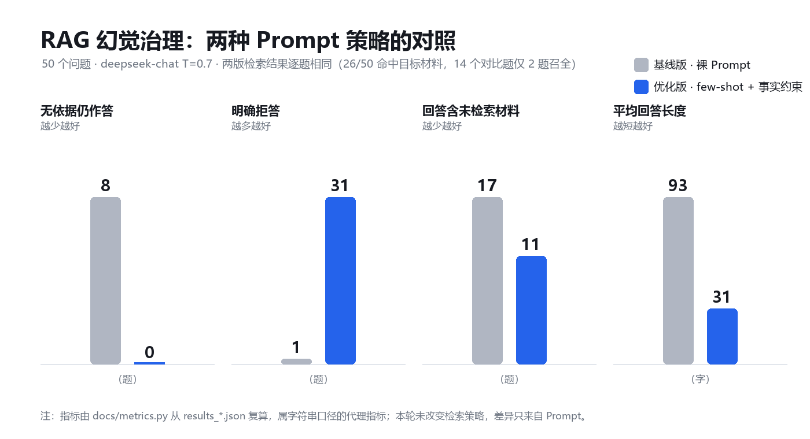

# RAG 幻觉治理与评测优化

一个关于「**模型什么时候该闭嘴**」的小型对照实验。

同一份语料（15 种床垫材料的说明文档）、同一批 50 个测试问题、同一条生成链路（`deepseek-chat`, `temperature 0.7`）、**完全相同的检索结果**，只把 Prompt 从「裸指令」换成「few-shot + 事实约束」，看模型行为怎么变。

结论先说：**检索没变，回答从"编"变成了"拒答"。**

---

## 1. 实验设计（先看清楚变量）

仓库里有两套 Prompt：

| | `rag_core_baseline.py` | `rag_core_optimized.py` |
|---|---|---|
| 检索 | Sentence-Transformer 向量检索 top-3 | **同上**（同一套 `search()`） |
| Prompt | `根据以下材料回答问题：{context}\n问题：{question}\n回答：` | 3 条 few-shot 示例 + 事实约束（「只能使用下面的材料说明，无依据时明确说"材料库中未提及"」）+ 上下文/对话历史管理 |
| 生成模型与参数 | `deepseek-chat`, T=0.7 | 同左 |

**关键点：两版的检索结果逐题完全相同。** 这不是疏漏，而是本轮刻意只动一个变量 —— `rag_core_optimized.py` 里走的仍然是 `search()`（向量 top-3），混合检索模块 `hybrid_retriever.py` 在这轮评测里**没有接入**（详见第 5 节）。

所以下面的数字只能归因到 Prompt，不能归因到检索。

## 2. 结果



| 指标（50 题） | 基线版 | 优化版 | 说明 |
|---|---|---|---|
| 无依据仍作答 | 8 | **0** | 目标材料没被检索到、回答里也没说「未提及」 |
| 明确拒答 | 1 | **31** | 回答里出现「材料库中未提及」这类表述 |
| 回答含未检索材料 | 17 | 11 | 回答提到的材料名不在当次检索片段里 |
| 平均回答长度 | 93 字 | **31 字** | 拒答比长篇解释短得多 |

这些数字全部可以用 [`docs/metrics.py`](docs/metrics.py) 从仓库里的 `results_*.json` 复算，不依赖人工判断：

```bash
python docs/metrics.py           # 打印指标
python docs/metrics.py --chart   # 重新生成 docs/comparison.png
```

### 一个具体例子

问：「天然新疆棉和驼绒有什么区别」——语料里没有任何关于驼绒的说明。

- 基线版：`根据你提供的材料，**无法判断天然新疆棉和驼绒的区别**，因为材料中只介绍了：- 天然新疆棉：柔软亲肤……` —— 这一题它答得不错；但同一批基线回答里，问「驼绒适合什么人」「雪绒棉有什么特点」时就直接编了。
- 优化版：`材料库中未提及"驼绒"，无法比较。天然新疆棉的特点是柔软亲肤……` —— 先明确边界，再回答能回答的部分。

## 3. 为什么会这样

这批问题里有相当一部分是**语料覆盖不到的**：15 种材料只有 8 种被写进了 `data/materials.md`，而测试集照样问了雪绒棉、酷布网、mini簧、麻布袋、四叶草科技酷布、羊毛q弹棉、纯棉梭织布。

- 检索层对这类问题无能为力 —— 语料里没有，召回再多也是空的。50 题里 26 题召回到了目标材料；14 个对比类问题里，只有 2 题把两个材料都召全。
- 于是模型的默认行为就变成「编」：它知道床垫材料的常识，也很乐意补全。
- 优化版做的事很简单：**把「没依据就说没提及」写进 Prompt，再给 3 个正例示范格式**。模型于是从"自信地编"切到"先声明边界再回答"。

这也是这个实验真正的结论：**在语料覆盖不全的场景里，最便宜、最有效的幻觉治理是先让模型学会拒答，而不是先去调检索。**

## 4. 文件结构

| 文件 | 作用 |
|---|---|
| `rag_core_baseline.py` | 基线：向量检索 top-3 + 裸 Prompt |
| `rag_core_optimized.py` | 优化：同一检索 + few-shot 与事实约束 Prompt |
| `hybrid_retriever.py` | BM25 / 向量 / RRF 融合 / Cross-Encoder 重排 —— **本轮评测未接入** |
| `context_manager.py` | few-shot Prompt、滑动窗口 `ConversationHistory`、摘要压缩 |
| `fault_tolerance.py` | `retry_with_timeout` / `classify_error` / `fallback_to_mysql` |
| `mattress_db.py` | MySQL 数据层 + ChromaDB 失败时的模糊查询兜底 |
| `test_questions.py` | 50 个测试问题（对比 / 适用人群 / 保养 / 极值 / 场景） |
| `run_ragas.py` | RAGAS（Faithfulness / Answer Relevancy）评测入口 |
| `data/materials.md` | 15 种材料里被写入语料的 8 条说明 |
| `docs/metrics.py` | 指标复算 + 对比图生成脚本 |
| `results_*.json` | 两版逐题输出（含当次检索到的片段） |

## 5. 混合检索模块（已实现，未接入本轮评测）

[`hybrid_retriever.py`](hybrid_retriever.py) 里实现了完整链路：

```
bm25_search(top-50) ─┐
                     ├─ rrf_fusion(k=60) ─ rerank(Cross-Encoder, top-5)
vector_search(top-50)┘
```

设计意图是补向量检索的短板：专有名词（「驼绒」「酷布弹簧20高9环」）在向量空间里不占优势，靠 BM25 字面匹配补；两路分数不可比，RRF 只对名次融合；融合后 Top-50 仍有噪声，再用 Cross-Encoder 对「问题-文档」联合编码精排。

**但它没有接进 `rag_core_optimized.py` 的检索路径**，原因很实际：跑通需要 `chromadb` + `sentence-transformers`，以及两个模型（`all-MiniLM-L6-v2`、`cross-encoder/ms-marco-MiniLM-L6-v2`）的下载。当前环境不具备，所以本轮只验证了 Prompt 这一层。

要接入，改动很小 —— 把 `rag_core_optimized.py` 里的 `docs = search(...)` 换成：

```python
from hybrid_retriever import hybrid_search
docs = hybrid_search(query, chunks, collection, model)   # 返回 top-5
```

然后重跑 50 题、重新生成 `results_optimized.json`，才能得到「检索层贡献了多少」的对照数据。**在那之前，本仓库不声称检索优化带来了多少收益。**

## 6. 容错设计

链路里任何一环挂掉都不应该让整条问答失败：

- `retry_with_timeout(func, max_retries=3, timeout=10)`：单次查询超时即中断；
- `classify_error`：区分 `timeout` / `connection` / `data` 三类 —— **数据类错误不重试**（重试也不会变对）；
- `fallback_to_mysql`：ChromaDB 检索失败时退回 MySQL 关键词模糊查，宁可降级也别整体报错。

## 7. 运行

```bash
python -m venv .venv && source .venv/bin/activate     # Windows: .venv\Scripts\activate
pip install -r requirements.txt
cp .env.example .env          # 填 DEEPSEEK_API_KEY

export HF_ENDPOINT=https://hf-mirror.com   # 国内下载模型加速
python rag_core_baseline.py                # 50 题 → results_baseline.json
python rag_core_optimized.py               # 50 题 → results_optimized.json
python run_ragas.py                        # RAGAS 打分（需自行落盘结果）
python docs/metrics.py --chart             # 指标 + 对比图
```

> RAGAS 的 Faithfulness 分数本轮没有随结果落盘，因此仓库里不引用任何具体分值 —— 需要的话跑 `run_ragas.py` 自己出一份。

## 8. 局限与下一步

- **只验证了 Prompt 层**：检索层的收益还是空白，这是最该补的实验（见第 5 节）。
- **语料覆盖不全**：15 种材料只写了 8 种，一半问题天然无解；这本身值得单独讨论 —— 是补语料，还是接受"覆盖不全 + 明确拒答"作为诚实的产品行为。
- **中文没做专门处理**：`bm25_search` 现在按字符切分（`list(c)`），中文应换 jieba 分词；embedding 也该换 `text2vec-base-chinese`。
- **幻觉判定偏代理**：现在是「材料名是否被检索覆盖」这类字符串口径；上 claim-level NLI 才能定位到句子级。

## 9. License

[MIT](LICENSE) © 2026 Mar-alf
